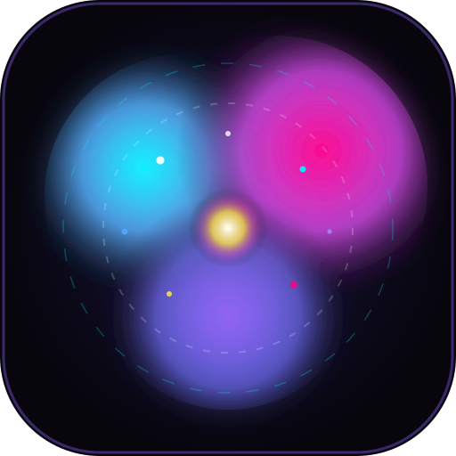

<div align="center">



# NebulaFlow

**Ditado por voz inteligente para Linux com visualizador reativo em tempo real e colagem automática.**

Inspirado no Wispr Flow. Roda 100% offline via OpenAI Whisper com aceleração por GPU.

[](https://python.org)
[-FCC624?style=flat-square&logo=linux&logoColor=black)](#-requisitos)
[-41CD52?style=flat-square&logo=qt&logoColor=white)](https://pyside.org)
[](https://github.com/openai/whisper)
[](#aceleração-por-gpu-nvidia-cuda)

<br/>


<br/>

[Como Funciona](#-como-funciona) &nbsp;•&nbsp;
[Instalação](#-instalação) &nbsp;•&nbsp;
[Uso & Atalhos](#-uso--atalhos) &nbsp;•&nbsp;
[Comandos CLI](#-comandos-cli) &nbsp;•&nbsp;
[Configuração](#-configuração) &nbsp;•&nbsp;
[Inicialização Automática](#-autostart-com-systemd)

</div>

---

## ⚡ Como Funciona

O **NebulaFlow** opera como um daemon em segundo plano com um HUD flutuante ultraleve em PySide6/Qt6:

```
[ Pressiona Atalho ] ──> [ HUD Ativo / Gravação ] ──> [ Pausa de Voz / Atalho ]
                                                              │
                                                              ▼
[ App Focado Recebe o Texto ] <── [ Auto-Paste ] <── [ Transcrição Whisper Local ]
```

1. **Acione de qualquer lugar**: Pressione <kbd>Super</kbd> + <kbd>Alt</kbd> + <kbd>Espaço</kbd> sobre qualquer aplicativo (VS Code, terminal, navegador, mensageiro).
2. **Fale naturalmente**: A barra flutuante surge suavemente e reage em tempo real à amplitude da sua voz.
3. **Parada inteligente**: Faça uma pausa (detecção de silêncio configurável) ou aperte o atalho novamente.
4. **Inserção instantânea**: O áudio é transcrito pelo Whisper e digitado diretamente onde o cursor estiver focado.

> [!TIP]
> **Preservação de Clipboard**: Por padrão, o NebulaFlow não limpa nem substitui o que você já tinha na sua área de transferência antes de falar.

---

## 🎯 Principais Recursos

| Recurso | Detalhes |
| :--- | :--- |
| **Transcrição 100% Local** | Privacidade total: seus áudios nunca saem da sua máquina. Suporte aos modelos `tiny`, `base`, `small` e `medium`. |
| **Aceleração por Hardware** | Processamento via PyTorch com CUDA (latência típica < 300ms com modelo `base`/`small`) ou fallback para CPU. |
| **Integração Wayland & X11** | Atalho global configurado via `gsettings` no GNOME, compatível com sessões modernas do Ubuntu e Fedora. |
| **Auto-Paste Inteligente** | Suporta digitação direta via extensão GNOME *EmojifyBridge* ou fallback universal com `xdotool` e `wl-copy`/`xclip`. |
| **HUD Minimalista & Arrastável** | Barra de pontinhos com degradê suave; arraste para qualquer lugar da tela e solte. |
| **IPC de Baixa Latência** | Comunicação entre processos via UNIX Domain Sockets (`/tmp/nebulaflow_$UID.sock`) com tempo de resposta imediato. |
| **Painel de Controle Gráfico** | Teste ao vivo de microfone, gravador interativo de atalhos e seleção de idiomas (`pt`, `en`, `es`, `auto`). |

---

## 📦 Requisitos

### Dependências de Sistema

Instale os pacotes de áudio e utilitários de teclado da sua distribuição:

# Ubuntu / Debian / Pop!_OS
```bash
sudo apt update && sudo apt install -y \
  python3 python3-pip python3-venv ffmpeg \
  libportaudio2 xdotool xclip wl-clipboard
```

# Fedora / RHEL
```bash
sudo dnf install -y \
  python3 python3-pip ffmpeg portaudio \
  xdotool xclip wl-clipboard
```

# Arch Linux
```bash
sudo pacman -S --needed \
  python python-pip ffmpeg portaudio \
  xdotool xclip wl-clipboard
```

### Aceleração por GPU (NVIDIA CUDA)

Para obter transcrições instantâneas, instale o PyTorch compilado com suporte a CUDA no seu ambiente:

```bash
pip install torch --index-url https://download.pytorch.org/whl/cu121
```

*(Se não possuir GPU NVIDIA, o NebulaFlow rodará automaticamente na CPU utilizando FP32).*

---

## 🚀 Instalação

```bash
# 1. Clone o repositório
git clone https://github.com/seu-usuario/NebulaFlow.git
cd NebulaFlow

# 2. Crie e ative o ambiente virtual
python3 -m venv venv
source venv/bin/activate

# 3. Instale as dependências Python
pip install -r requirements.txt
```

---

## ⌨️ Uso & Atalhos

Inicie a aplicação:

```bash
python3 main.py
```

- **Primeira execução**: A tela de configurações se abrirá para ajustar seu microfone, modelo desejado e atalho. O atalho global é registrado automaticamente no GNOME.
- **Bandeja do sistema**: O ícone do NebulaFlow permanece na barra superior para acesso rápido às configurações ou saída do aplicativo.
- **Atalho padrão**: <kbd>Super</kbd> + <kbd>Alt</kbd> + <kbd>Espaço</kbd> (personalizável nas preferências).
- **Fechar HUD**: Tecla <kbd>Esc</kbd> ou botão `✕` discreto na barra.

---

## 💻 Comandos CLI

O executável comunica-se diretamente com o daemon em execução através de IPC:

```bash
python3 main.py --toggle      # Alterna exibição do HUD e inicia/para gravação
python3 main.py --config      # Abre a janela de configurações
python3 main.py --show        # Força a exibição do HUD
python3 main.py --hide        # Oculta o HUD
python3 main.py --register    # Registra o atalho global no daemon de atalhos do GNOME
python3 main.py --unregister  # Remove o atalho global do sistema
```

---

## ⚙️ Configuração

O arquivo de preferências fica localizado em:
`~/.config/nebulaflow/config.json`

| Chave | Tipo | Padrão | Descrição |
| :--- | :---: | :---: | :--- |
| `whisper_model` | `string` | `"small"` | Modelo do Whisper (`tiny`, `base`, `small`, `medium`) |
| `language` | `string` | `"pt"` | Idioma de transcrição (`pt`, `en`, `es`, `auto`) |
| `device` | `string` | `"auto"` | Dispositivo de inferência (`auto`, `cuda`, `cpu`) |
| `hotkey` | `string` | `"<Super><Alt>space"` | Formato de atalho global para o GNOME |
| `silence_timeout` | `float` | `1.4` | Segundos de silêncio para parada automática (`0` para desativar) |
| `auto_paste` | `bool` | `true` | Cola o texto transcrito diretamente na janela ativa |
| `auto_copy` | `bool` | `false` | Se `true`, substitui a área de transferência pelo ditado |
| `sound_effects` | `bool` | `true` | Efeitos sonoros suaves de início e conclusão |
| `hud_position` | `string` | `"bottom-center"` | Posição inicial (`bottom-center`, `top-center`, `center`) |
| `mic_device_index`| `int/null`| `null` | Índice do microfone (`null` usa o padrão do sistema) |

---

## 🔄 Autostart com systemd

<details>
<summary><b>Clique para ver as instruções de inicialização automática no login</b></summary>
<br>

Você pode criar um serviço de usuário no systemd para que o NebulaFlow inicie silenciosamente com o sistema:

1. Crie o arquivo de serviço:
   ```bash
   mkdir -p ~/.config/systemd/user
   nano ~/.config/systemd/user/nebulaflow.service
   ```

2. Cole a definição do serviço (ajuste o caminho para o seu diretório):
   ```ini
   [Unit]
   Description=NebulaFlow Voice Dictation Service
   After=graphical-session.target

   [Service]
   Type=simple
   ExecStart=%h/caminho/para/NebulaFlow/venv/bin/python %h/caminho/para/NebulaFlow/main.py
   Restart=on-failure
   Environment=PYTHONPATH=%h/caminho/para/NebulaFlow

   [Install]
   WantedBy=default.target
   ```

3. Recarregue e inicie o serviço:
   ```bash
   systemctl --user daemon-reload
   systemctl --user enable --now nebulaflow.service
   ```
</details>

---

## 📄 Licença

Distribuído sob a licença MIT. Consulte `LICENSE` para mais detalhes.
